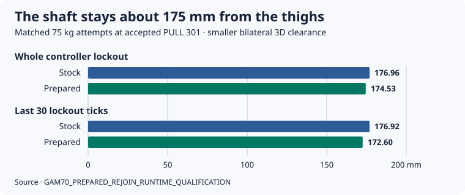

# GAM-70 — Deadlift bar stays too far from the body

**Status** Geometry fixed at the qualified onset. Robustness and owner acceptance are still open. **Scope** Deadlift above-knee ascent and lockout. **Originally reviewed head** `4f1f62c`; updated for contract v2, draft PR #32. [Linear issue](https://linear.app/alignerr-cmj/issue/GAM-70/build-complete-physical-deadlift-ipf-judging-and-playable-windows) · [Draft PR](https://github.com/Litju/PowerliftingSimulator/pull/32)

## Current state (contract v2, hips-through lockout)

The shipped close-bar reference now brings the hips through to the bar (mechanism C). The bar keeps its supportable fore-aft place, and the pelvis advances 52.7 mm through the planted ankles, knees and hips. Measured results:

| Measure | Before | v2 |
| --- | ---: | ---: |
| Mean lockout shaft-to-thigh-collider gap, complete judged lift at onset 301 | 176.96 mm (stock), 95.66 mm (v1 close-bar) | **42.38 mm** |
| Isolated lockout hold, 300 ticks: collider gap | 92.5 mm | 44.30 mm |
| Isolated lockout hold, 300 ticks: visible skinned-thigh gap | about 59 mm | **5.56 mm** |
| Minimum ascent shin gap, sampled every substep | — | 10.89 mm |
| Minimum lowering shin gap, sampled every substep (bar slides down the shins) | — | 0.74 mm, zero contact force |

The complete lift at onset 301 is a GOOD LIFT. DOWN comes at tick 790, followed by a controlled return and supported grip release. The minimum airborne foot load is 559.1 N, and no thigh support or bar-on-leg force was reported. [Reference evidence](reference-cache-admission.md#contract-v2-hips-through-reference-shipped) · [Endpoint evidence](suspended-lockout-endpoint.md)

**Not yet closed:**

- **Onset robustness.** v2 completes 3 of 8 player Drive onsets, against 6 of 8 for v1. Five new failures are single-foot support losses in the post-knee window under corrected admission. One bounded correction was tried, and it was negative and reverted. [Causal trace](reference-cache-admission.md#causal-trace-of-the-post-knee-failures)
- **Owner sign-off.** The owner has not yet accepted the gameplay on hardware.

## Summary (original report, superseded measurements)

The default 75 kg sumo deadlift still finishes with the shaft visibly forward of the thighs. In a matched pair of successful Unity attempts, the mean realized shaft-to-thigh gap at controller lockout was **176.96 mm stock and 174.53 mm prepared**. The prepared rehearsal closes only **2.43 mm (1.37%)** on average. During the last 30 lockout ticks it still leaves **172.60 mm** of clearance. The W fix makes the rehearsal start on command. It leaves the geometry described here in place. [Measured transition and input evidence](prepared-transition.md#keyboard-start-and-responsive-rehearsal)

## Reproduction

1. Launch the Windows deadlift station with the default path. Use **V** or `-deadliftSideView` for the side-quarter camera. When ready, hold **W** or **Up**. Observe the shaft as it clears the knees and again before DOWN.
2. Launch the same station with `-deadliftPreparedRehearsal -deadliftSideView`. Press **W** or **Up** once to start the rehearsal. Let the reference solve finish and observe the same phase. **R** resets to the start prompt.
3. For deterministic measurements, run `GAM70_PREPARED_REJOIN_RUNTIME_QUALIFICATION` in Unity PlayMode. It compares the original reference and the prepared rejoin on fresh B2 plants at accepted PULL tick 301. For the separate closer-path experiment, use `GAM70_BAR_LEG_GEOMETRY_PLANNED_AND_REALIZED` and the onset robustness test in the same fixture. [Runtime qualification](../../../Assets/Tests/Deadlift/PlayMode/DeadliftTransitionTests.cs#L162) · [Geometry fixture](../../../Assets/Tests/Deadlift/PlayMode/DeadliftBarProximityTests.cs#L419)

**Expected behavior.** The bar follows the body closely above the knees and at lockout while staying clear of the leg colliders. The athlete maintains bilateral support through a judged lift, DOWN, controlled lowering and release.

**Actual behavior.** The stock and prepared paths can earn GOOD LIFT with the bar still well forward of the thighs. The older proximity path reaches a substantially closer position during ascent and later loses support. [Windows side-view evidence](gate9-windows-side-ab.png) · [Historical experiment](gate9-bar-proximity.txt)

## Phase measurements

The paired traces report the smaller left/right **3D surface clearance** from the live shaft capsule to the live leg capsule. Values are in millimetres. The samples are individual physics ticks from two attempts, rather than independent lifts. Controller phase identifies lockout. In lifting and separated phases, the knee window spans ±30 mm around the mean knee-axis height. [Measurement code](../../../Assets/Scripts/Deadlift/Unity/DeadliftBarLegGeometry.cs#L82)

| Window and measure | Stock | Prepared | Prepared minus stock |
|---|---:|---:|---:|
| Below knee, minimum shaft-to-shin | 0.56 | 10.89 | +10.33 |
| Knee passage, mean shaft-to-thigh | 104.17 | 107.05 | +2.88 |
| Above knee, mean shaft-to-thigh | 172.55 | 170.48 | −2.07 |
| Lockout, mean shaft-to-thigh (144 / 145 ticks) | 176.96 | 174.53 | −2.43 |
| Last 30 lockout ticks, mean shaft-to-thigh | 176.92 | 172.60 | −4.33 |

The prepared reference gives the shins more clearance. Its above-knee improvement varies with bar height. At 650–700 mm of rise, the prepared thigh gap averages **191.80 mm** against **190.13 mm** stock. At 750–800 mm of rise it averages **231.42 mm** against **230.76 mm** stock. These bins use the bar’s realized height and exclude the lockout hold. Both matched attempts reached GOOD LIFT and had zero reported bar-leg force. [Paired stock trace](../../../Logs/GAM70/transition-rejoin-stock-control.csv) · [Paired prepared trace](../../../Logs/GAM70/transition-rejoin-runtime-301.csv)

## Why the bar stays forward

- **The stock reference already asks for the large gap.** Gate 9 measured approximately 179 mm planned and 177 mm realized at stock lockout. The same audit measured about 156 mm to the visible thigh mesh. In the reviewed stock trace, the bar axis averaged **267 mm forward of the shoulder centers** in world Z at lockout. The rendered body and capsule measurements support the same complaint. The 267 mm value measures fore–aft landmark separation, while 177 mm measures the nearest surface gap. [Gate 9 geometry and mesh measurements](gate9-bar-proximity.txt)
- **Stock stance geometry restricts the hip path.** The stock planner parameterizes planted ankle and knee motion as hinges in the toed-out B2 stance. That restricts forward hip travel in the plan, and the resulting lockout leaves the shoulders back with the bar forward. The rig already has an ankle-roll degree of freedom. The closer-path experiment used it in the reference. [Planner and causal evidence](gate9-bar-proximity.txt)
- **The prepared rehearsal returns to the stock reference above the knee.** It blends back by progress 0.80 and applies a bounded **0.50°** shoulder trim after entering Lockout and slowing below **45 mm/s**. The station selects the proximity or prepared branch separately. Opening the prepared rehearsal therefore selects the clearance-and-rejoin path with the small settled trim. [Path selection](../../../Assets/Scripts/Deadlift/Unity/DeadliftStationController.cs#L88) · [Stock rejoin and trim](../../../Assets/Scripts/Deadlift/Unity/DeadliftPreparedRejoin.cs#L12)

## What the attempted fixes established

| Intervention | Observed result |
|---|---|
| Dedicated proximity path | At nearly the same **physical bar height** around 0.931 m during ascent, the historical proximity sample had a **74.9 mm** thigh gap and the stock sample had **192.3 mm**. Both had bilateral load at those samples. The proximity arm later lost a foot and completed **0/5** in the historical onset sweep. The sample measures ascent clearance, and the proximity arm never registered controller lockout in that trace. |
| Maintain the grounded shoulder offset | Removed the early release transient but produced a shin contact at tick 374. The original release arm contacted a shin at tick 382. |
| Prepare from the measured plant, then rejoin stock | Cleared the knee region and recovered complete judged lifts at onset 301. Before the settled trim, whole-lockout thigh clearance averaged approximately 177 mm. |
| Apply the 0.50° shoulder trim during moving ascent | Lost support at tick 686. Negative trim completed a good lift with a wider mean thigh gap of 181.41 mm. |
| Wait for lockout and slow bar motion before adding the trim | Qualified the matched 301 case with **174.53 mm** mean clearance. Both later prepared onset protocols completed **1/5**. Other timings ended on downward motion, leg contact or support loss. |
| Fix W-to-start and show solve progress | The Windows W-start run reached DOWN at 856 before the window closed during lowering. The W-triggered Unity station test completed GOOD LIFT. These are input and judged-completion receipts. |

In the separate near-standing actuator probe, the left foot reached its fore–aft edge at tick 637 before ankle-roll demand crossed its ceiling. Both signs of the bounded roll pulse eventually lost support. The evidence supports a contact transition before saturation and leaves the robust posture/control solution open. [Prepared experiments and near-standing probe](prepared-transition.md#ankle-roll-after-knee-clearance) · [Historical proximity trace](../../../Logs/GAM70/upper-chain-proximity-control.csv) · [Historical stock trace](../../../Logs/GAM70/upper-chain-original-control.csv)

## Closure criteria and evidence limits

| Criterion | State |
| --- | --- |
| **Measurable target.** Set a player-visible and measurable thigh-clearance target for above-knee ascent and settled lockout. Validate it with the side-quarter view, 3D shaft-to-capsule distances and a current visual-mesh measurement. | **Met for lockout.** Collider gap 42–44 mm; visible-mesh gap 5.56 mm at the isolated hold. The visible-mesh gap was not re-measured during the moving lift. |
| **Sustained improvement.** Show improvement through settled lockout while preserving shin clearance, bilateral support, GOOD LIFT, DOWN and controlled return. | **Met at the qualified onset 301** (live solve and cached admission). |
| **Repeat across onsets.** Repeat the result across the existing onset cases. | **Not met.** 3 of 8 Drive onsets and 1 of 5 PULL onsets complete. |
| **Repeat in the Windows station.** Repeat the result in the standalone Windows station. | **Not met.** Owner hardware rehearsal of the v2 build is pending. |
| **Authorized settings.** Keep ankle gains, capacities, contact geometry, grips and referee rules at their authorized settings. | **Held**, with one exception: the regulator's roll clamp was re-derived from 8° to 5.5° in `e19b998` so that plan + clamp + margin fits the 15° physical limit. No gain or capacity changed. |

This report recomputes measurements from the saved matched traces and reviews the current branch selection and Windows receipts. The historical screenshot shows the late-ascent comparison on an earlier build. A fresh visual-mesh measurement and a complete owner-keyed Windows recording for the current head are still missing. The Windows W-start log records the run through DOWN. [Latest Windows W-start log](../../../Logs/gam70-keyboard-rehearsal-player.log) · [Complete PlayMode evidence](prepared-transition.md#keyboard-start-and-responsive-rehearsal)
